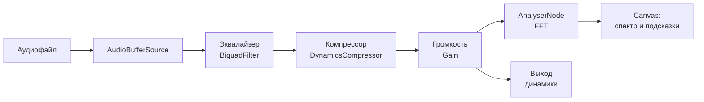

# 🎚️ Sound Helper — веб-сайт для помощи в сведении и мастеринге звука

> Бесплатный браузерный инструмент, который анализирует звук, показывает спектр и даёт понятные подсказки по сведению и мастерингу — без установки тяжёлых DAW и без серверной обработки.

Курсовой проект по дисциплине «Проектная деятельность 1», Сибирский государственный индустриальный университет (СибГИУ), кафедра прикладных информационных технологий и программирования, гр. ИП-24.

> ⚠️ Название «Sound Helper» — рабочее, замените на своё.

## Зачем это нужно

Начинающие музыканты, битмейкеры, подкастеры и видеоблогеры часто не умеют сводить треки: звук получается «глухим», «грязным», «тихим» или «плоским». Профессиональные DAW требуют обучения и мощного железа, а онлайн-сервисы платные, сложные или не дают наглядных подсказок. Этот сайт решает проблему: загрузите трек, посмотрите спектр и получите рекомендации прямо в браузере.

## Скриншоты

<!-- Добавьте скриншот или GIF главного экрана, когда будет готов интерфейс -->


## Основные возможности

- 📂 Загрузка и воспроизведение аудиофайла в браузере
- 📊 Визуализация спектра и спектрограммы в реальном времени (FFT)
- 🔍 Выделение проблемных частот на спектрограмме
- 💡 Автоматические подсказки по сведению: баланс частот, панорама, динамика
- 🎯 Рекомендации по мастерингу: уровень громкости, динамический диапазон, баланс
- 🎛️ Ручные инструменты: эквалайзер, компрессор, регулятор громкости
- 📖 Встроенный раздел «Справка» с простыми пояснениями терминов
- 🌐 Кроссплатформенность: работает в Chrome, Firefox, Edge на Windows, macOS, Linux и в мобильных браузерах
- 🔒 Вся обработка выполняется на стороне клиента — файлы не уходят на сервер

## Для кого

| Аудитория | Что получает |
|---|---|
| Начинающие битмейкеры и музыканты | Подсказки по улучшению микса без глубоких знаний |
| Студенты-звукорежиссёры | Учебный тренажёр для практики теории |
| Опытные звукорежиссёры | Быстрая проверка трека без запуска DAW |
| Преподаватели | Наглядная демонстрация спектроанализатора и эффектов |

## Технологии

- **HTML5 / CSS3 / JavaScript** — структура, оформление и логика
- **Web Audio API** — ядро обработки звука (`AnalyserNode`, `BiquadFilterNode`, `DynamicsCompressorNode`, `GainNode`)
- **Canvas API** — отрисовка спектра и спектрограммы
- **Инструменты разработки:** Visual Studio Code, GitHub, Figma, draw.io, MS Project

### Цепочка обработки звука



## Установка

Требуется только современный браузер (Chrome, Firefox, Edge). Серверная часть не нужна.

```bash
git clone https://github.com/<ваш-аккаунт>/<название-репозитория>.git
cd <название-репозитория>
```

Затем откройте `index.html` в браузере двойным кликом. Если браузер ограничивает работу с локальными файлами, запустите локальный сервер:

```bash
# вариант 1 — Python
python -m http.server 8000

# вариант 2 — Node.js
npx serve .
```

После этого откройте в браузере http://localhost:8000.

## Использование

1. Откройте сайт и нажмите **«Загрузить трек»** (поддерживаются форматы, которые воспроизводит браузер: WAV, MP3, OGG и др.).
2. Нажмите **▶ Воспроизвести** — на экране появится спектр и спектрограмма.
3. Прочитайте **подсказки**: проблемные частоты подсвечиваются на графике, рядом выводятся рекомендации.
4. При необходимости настройте звук вручную:
   - **Эквалайзер** — коррекция частотных полос;
   - **Компрессор** — управление динамикой;
   - **Громкость** — итоговый уровень трека.
5. Сверьтесь с **рекомендациями по мастерингу** (громкость, динамика, баланс).

## Структура проекта

> Предполагаемая структура — приведите её в соответствие с реальным репозиторием.

```text
.
├── index.html          # главная с
